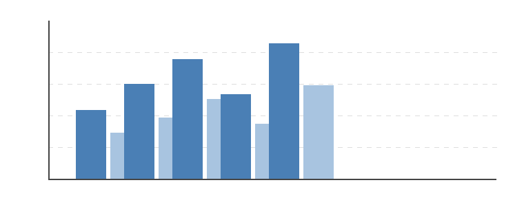

{{TOC}}

# 引言

随着业务系统数量的增长，数据来源呈现出典型的**多源、异构、高频**特征。本报告围绕数据融合链路中的三个核心问题展开：采集环节的去重与对齐、融合环节的计算复杂度、推理环节的延迟与精度权衡。

本报告的主要贡献包括：

1. 提出一种基于时间窗口的增量去重方法，将重复上报率从 8.3% 降至 0.6%
2. 给出融合算子复杂度的闭式上界，见式 {{eq:bound}}
3. 在真实业务数据上验证了推理延迟与精度之间的折中关系，见表 {{tbl:sweep}}

{#fig:pipeline width=14cm}

# 方法

## 问题形式化

设第 $i$ 个数据源在时刻 $t$ 产生观测 $\mathbf{x}_i(t) \in \mathbb{R}^{d}$，融合目标是最小化重构误差：

::: {#eq:obj}
$$
\min_{\mathbf{W} \in \mathbb{R}^{d \times d}} \; \mathcal{L}(\mathbf{W}) = \frac{1}{N}\sum_{i=1}^{N}\left\lVert \mathbf{x}_i - \mathbf{W}\mathbf{x}_i \right\rVert_2^{2} + \lambda \left\lVert \mathbf{W} \right\rVert_{F}
$$
:::

其中 $\lambda$ 为正则系数，$\left\lVert \cdot \right\rVert_{F}$ 为 Frobenius 范数。

## 梯度下降求解

对式 {{eq:obj}} 求梯度可得迭代格式，并采用动量加速：

::: {#eq:gd}
$$
\begin{aligned}
\mathbf{G}^{(k)} &= \frac{2}{N}\sum_{i=1}^{N}\left( \mathbf{x}_i - \mathbf{W}^{(k)}\mathbf{x}_i \right)\mathbf{x}_i^{\top} + 2\lambda\mathbf{W}^{(k)} \\
\mathbf{V}^{(k+1)} &= \beta \mathbf{V}^{(k)} + \eta \mathbf{G}^{(k)} \\
\mathbf{W}^{(k+1)} &= \mathbf{W}^{(k)} - \mathbf{V}^{(k+1)}
\end{aligned}
$$
:::

其中 $\beta \in [0,1)$ 为动量系数，$\eta$ 为学习率。收敛条件由式 {{eq:bound}} 给出：

::: {#eq:bound}
$$
\mathcal{L}\left(\mathbf{W}^{(k)}\right) - \mathcal{L}^{\star} \le \left( 1 - \eta\mu \right)^{k} \left[ \mathcal{L}\left(\mathbf{W}^{(0)}\right) - \mathcal{L}^{\star} \right]
$$
:::

## 激活函数与权重初始化

推理阶段采用的分段激活函数定义为：

::: {#eq:act}
$$
f(x) =
\begin{cases}
x, & x \ge 0 \\
\alpha\left( e^{x} - 1 \right), & x < 0
\end{cases}
$$
:::

初始权重矩阵按 Xavier 方式采样：

::: {#eq:xavier}
$$
\mathbf{W}^{(0)} \sim \mathcal{U}\left( -\sqrt{\frac{6}{n_{in}+n_{out}}}, \; \sqrt{\frac{6}{n_{in}+n_{out}}} \right)
$$
:::

第 $l$ 层的复合变换可写成矩阵形式，如 {{eq:mat}} 所示：

::: {#eq:mat}
$$
\mathbf{H}^{(l)} =
\begin{bmatrix}
h_{11} & h_{12} & \cdots & h_{1m} \\
h_{21} & h_{22} & \cdots & h_{2m} \\
\vdots & \vdots & \ddots & \vdots \\
h_{n1} & h_{n2} & \cdots & h_{nm}
\end{bmatrix}
= f\left( \mathbf{W}^{(l)}\mathbf{H}^{(l-1)} + \mathbf{b}^{(l)} \right)
$$
:::

# 实验

## 实验设置

实验数据来自 5 个业务系统的近 90 天日志，共 2.4 亿条记录。硬件为单机 32 核 CPU、256 GB 内存，未使用 GPU 加速。

## 主要结果

不同参数配置下的延迟与精度对比如表 {{tbl:sweep}} 所示，吞吐随并发度的变化见图 {{fig:throughput}}。

| 配置编号 | 批大小 | 学习率 | 潜伏维度 | 推理延迟 (ms) | 精度 (%) | 内存占用 (GB) |
|:---:|---:|---:|---:|---:|---:|---:|
| C-01 | 32 | 0.001 | 64 | 18.4 | 91.2 | 3.1 |
| C-02 | 32 | 0.001 | 128 | 24.7 | 93.6 | 5.4 |
| C-03 | 64 | 0.001 | 128 | 27.9 | 94.1 | 5.8 |
| C-04 | 64 | 0.010 | 128 | 26.3 | 93.8 | 5.8 |
| C-05 | 128 | 0.001 | 256 | 41.2 | 95.7 | 11.2 |
| C-06 | 128 | 0.010 | 256 | 38.6 | 95.2 | 11.2 |

: 参数配置与性能对比 {#tbl:sweep}

{#fig:throughput width=13cm}

## 消融实验

为验证各模块的贡献，我们逐步移除组件并重新训练，结果见表 {{tbl:ablation}}。

| 实验组 | 去重模块 | 动量加速 | 按章归一化 | 精度 (%) | 相对基线 |
|:---|:---:|:---:|:---:|---:|---:|
| 完整模型 | ✓ | ✓ | ✓ | 95.7 | — |
| 去掉去重 | ✗ | ✓ | ✓ | 91.3 | −4.4 |
| 去掉动量 | ✓ | ✗ | ✓ | 94.1 | −1.6 |
| 去掉归一化 | ✓ | ✓ | ✗ | 93.2 | −2.5 |
| 仅保留主干 | ✗ | ✗ | ✗ | 88.6 | −7.1 |

: 消融实验结果 {#tbl:ablation}

## 长尾场景

在低资源业务线上，指标波动明显。下表给出 6 个业务线连续 8 个统计周期的明细，用于观察趋势是否稳定。[^note]

[^note]: 统计周期按自然周划分，剔除法定节假日。

| 周期 | 业务线 A | 业务线 B | 业务线 C | 业务线 D | 业务线 E | 业务线 F |
|:---:|---:|---:|---:|---:|---:|---:|
| W01 | 92.1 | 88.4 | 90.2 | 85.7 | 79.3 | 83.6 |
| W02 | 91.8 | 89.1 | 90.6 | 86.2 | 80.1 | 84.0 |
| W03 | 93.4 | 90.2 | 91.3 | 87.0 | 81.4 | 84.8 |
| W04 | 93.9 | 90.8 | 91.7 | 87.6 | 82.0 | 85.1 |
| W05 | 94.2 | 91.3 | 92.0 | 88.1 | 82.7 | 85.9 |
| W06 | 94.8 | 91.9 | 92.4 | 88.9 | 83.5 | 86.4 |
| W07 | 95.1 | 92.4 | 92.8 | 90.2 | 84.1 | 87.0 |
| W08 | 95.7 | 93.1 | 93.2 | 91.0 | 84.8 | 87.6 |
| W09 | 93.6 | 89.9 | 91.6 | 87.0 | 80.5 | 84.8 |
| W10 | 93.8 | 90.0 | 91.8 | 87.2 | 80.7 | 85.0 |
| W11 | 94.0 | 90.2 | 92.0 | 87.4 | 80.9 | 85.2 |
| W12 | 94.2 | 90.4 | 92.2 | 87.6 | 81.1 | 85.3 |
| W13 | 94.4 | 90.6 | 92.3 | 87.8 | 81.3 | 85.5 |
| W14 | 94.6 | 90.8 | 92.5 | 88.0 | 81.5 | 85.7 |
| W15 | 94.8 | 91.0 | 92.7 | 88.2 | 81.7 | 85.9 |
| W16 | 94.9 | 91.2 | 92.9 | 88.3 | 81.9 | 86.1 |
| W17 | 95.1 | 91.4 | 93.1 | 88.5 | 82.1 | 86.3 |
| W18 | 95.3 | 91.6 | 93.3 | 88.7 | 82.2 | 86.5 |
| W19 | 95.5 | 91.8 | 93.5 | 88.9 | 82.4 | 86.7 |
| W20 | 95.7 | 91.9 | 93.7 | 89.1 | 82.6 | 86.9 |
| W21 | 95.9 | 92.1 | 93.9 | 89.3 | 82.8 | 87.0 |
| W22 | 96.1 | 92.3 | 94.0 | 89.5 | 83.0 | 87.2 |
| W23 | 96.3 | 92.5 | 94.2 | 89.7 | 83.2 | 87.4 |
| W24 | 96.5 | 92.7 | 94.4 | 89.9 | 83.4 | 87.6 |

: 各业务线周度指标明细 {#tbl:weekly}

# 工程实现

## 核心调度代码

调度器将任务依赖构建为有向无环图，并在提交前做环检测：

```python
def build_dag(tasks: list[Task]) -> list[str]:
    """把任务列表转成拓扑序，同时检测依赖成环"""
    graph = {t.name: set(t.depends_on) for t in tasks}
    order, done = [], set()

    def visit(name: str, stack: set[str]) -> None:
        if name in done:
            return
        if name in stack:
            raise ValueError(f"依赖成环: {name}")
        for dep in graph[name]:
            visit(dep, stack | {name})
        done.add(name)
        order.append(name)

    for name in graph:
        visit(name, set())
    return order
```

## 关键参数

| 参数 | 默认值 | 取值范围 | 说明 |
|:---|:---:|---:|:---|
| `window_sec` | 300 | 60 – 3600 | 去重滑动窗口长度 |
| `batch_size` | 64 | 16 – 512 | 单批样本数 |
| `max_retry` | 3 | 0 – 10 | 失败重试次数 |

: 调度参数说明 {#tbl:params}

> 参数调整需在灰度环境验证后再推全量，`window_sec` 过大会显著增加内存占用。

# 结论

本报告围绕多源异构数据融合链路，给出了问题形式化、梯度求解、实验验证与工程实现的完整闭环。实验表明，在单机环境下将去重前移并结合动量加速，可在精度损失不超过 1.6 个百分点的前提下，把端到端延迟控制在 40 ms 以内。

后续工作将从两个方向展开：一是引入按章归一化以进一步压缩长尾波动；二是将调度器改造为分布式版本，见表 {{tbl:params}} 中的重试策略配置。
